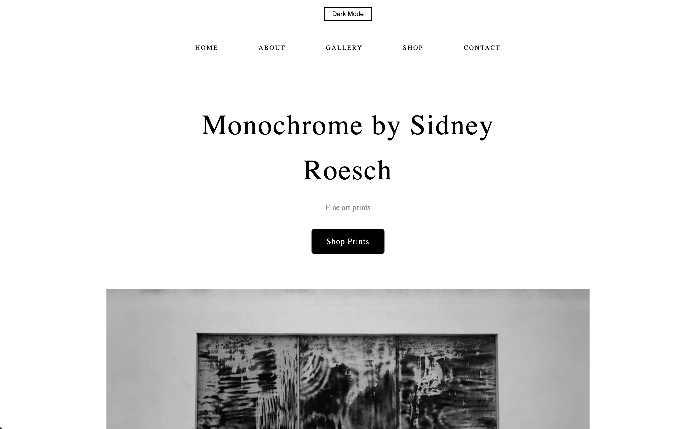

# Monochrome by Sidney Roesch
[🌐 View Live Website](https://sidneyroesch.github.io/monochrome-by-sidney-roesch/)

A minimalist photography portfolio website showcasing photography through a clean, monochromatic design.

## About the Project

Monochrome by Sidney Roesch is a photography portfolio project created to present photographic work in a simple and elegant digital environment.

The website focuses on visual presentation, minimalism and a clean user experience.

## Website Pages

- **Home** – Main landing page.
- **Gallery** – Photography collection.
- **About** – Information about the photographer.
- **Contact** – Contact page.
- **Shop** – Shop page.

## Technologies Used

- HTML5
- CSS3

## Project Structure

- `index.html` – Homepage
- `about.html` – About page
- `gallery.html` – Gallery page
- `contact.html` – Contact page
- `shop.html` – Shop page
- `styles.css` – Website styling
- `images/` – Photography and image assets

## Project Goals

- Create a minimalist photography portfolio.
- Practise HTML and CSS development.
- Develop skills in website structure and visual presentation.
- Build a foundation for future frontend development projects.

## Future Development

This project can be further developed with improved functionality, responsive design and additional frontend technologies.

---

**Created by Sidney Roesch**  
Photography Portfolio Project
